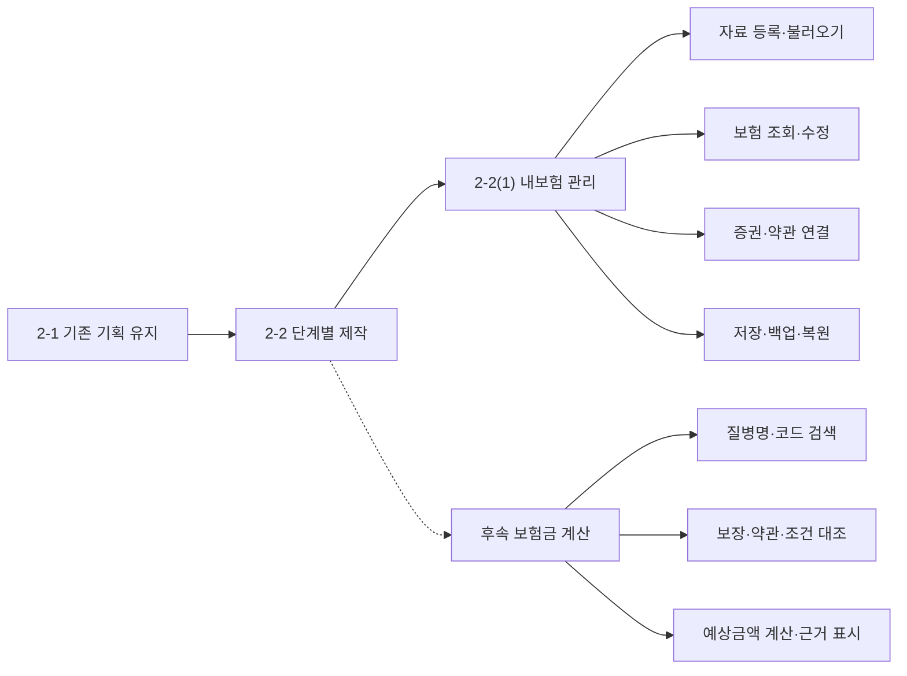
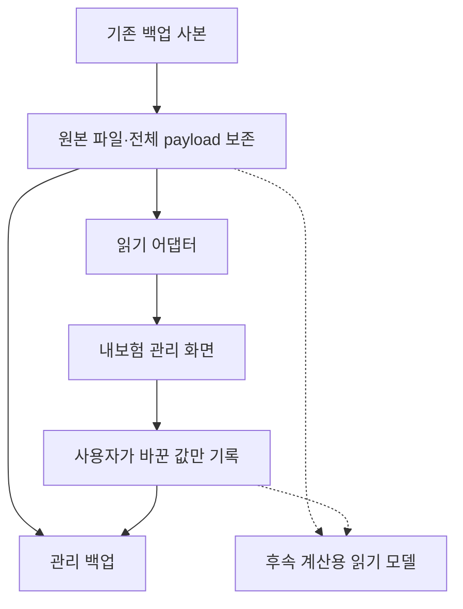

# 숨은보험금찾기 — 내보험 관리 개발기획서

> **미션 2-1의 기획을 유지하고, 미션 2-2(1)부터 내보험 관리를 단계적으로 제작한다.**
>
> 최우선 목표는 기존 보험 데이터 보존이다. 기획서 수정·기능 추가·앱 업데이트를 반복해도 계약, 보장, 증권, 약관 및 기존 계산 관련 정보가 손상되지 않도록 설계한다.

| 항목 | 내용 |
| --- | --- |
| 프로젝트 | 숨은보험금찾기 |
| 이번 개발 단계 | 미션 2-2(1) — 내보험 관리 |
| 문서 버전 | 기획 v1.1 |
| 수정일 | 2026-11-11, 한국 기준 |
| 작성일 | 2026-11-10, 한국 기준 |
| 사용자 | 본인 1명 |
| 최종 실행 형태 | PC·모바일 대응 단일 HTML |
| 현재 요청 범위 | 별도 GitHub 코드 저장소 준비 및 개발기획서 작성 |
| 이후 구현 범위 | 내보험 등록·조회·수정·문서 연결·저장·백업·복원 |
| 후속 확장 | 질병 검색·약관 대조·예상 보험금 계산 |
| 현재 상태 | 개발 계획. 이 문서는 HTML 구현이나 데이터 이관 검증의 완료 보고서가 아님 |

## 1. 기획 목적과 미션의 연결

### 1.1 유지할 최종 목표

기존 숨은보험금찾기의 최종 목표는 보유 보험의 증권과 약관을 대조하여 질병명 또는 진단코드를 검색했을 때 관련 보장과 계산 가능한 예상 보험금을 확인하는 것이다.

미션 2-1은 이미 완료했으므로 수정하지 않는다. 이번 문서는 미션 2-2 제작 단계의 구현 범위와 개발 순서를 정리하는 추가 문서다. 기존 기획서의 교체본으로 사용하지 않는다.

### 1.2 구현 순서를 나누는 이유

예상 보험금 계산에는 계약별 보장, 해당 약관, 적용 기간, 면책·감액, 지급 이력 등 여러 정보의 연결과 검증이 필요하다. 이를 한 번에 완성하려 하면 내보험 관리 기능까지 불안정해질 수 있다.

따라서 먼저 내보험 관리 기능을 독립적으로 사용할 수 있게 완성한다. 사용자가 자신의 보험과 가입 보장을 확인하고 자료를 안전하게 보관할 수 있는 상태를 이번 구현의 목표로 삼는다. 계산 기능은 검증된 관리 데이터에 연결하는 후속 단계로 둔다.

| 구분 | 이번 결정 | 기존 기획과의 관계 |
| --- | --- | --- |
| 미션 2-1 | 원본 유지, 수정하지 않음 | 전체 제품 목표의 기준 |
| 미션 2-2(1) | 내보험 관리 우선 구현 | 전체 기능의 첫 구현 단계 |
| 이후 개발 | 질병 검색·약관 대조·금액 계산 | 보존한 데이터에 연결하여 확장 |
| 기존 제작물·기록 | 덮어쓰거나 날짜·내용을 소급 수정하지 않음 | 이전 작업의 근거로 보관 |

후속 단계의 공식 미션 번호는 임의로 확정하지 않는다. 실제 제출 위치와 평가 항목은 수업의 원문 안내를 기준으로 확인한다. 이 문서가 평가 통과를 보장하는 것은 아니며, 구현 결과와 검증 근거를 명확하게 제시하는 데 목적이 있다.

## 2. 이번 요청에서 진행할 일과 이후에 할 일

| 구분 | 작업 | 완료의 의미 |
| --- | --- | --- |
| 이번 요청 | 별도 GitHub 저장소 생성 | 기존 저장소와 다른 새 저장소의 존재와 공개(Public) 설정 확인 |
| 이번 요청 | 개발기획서·README·제외 규칙 준비 | 범위·데이터 보존·업데이트·후속 확장 방법을 문서화 |
| 이번 요청 | 최초 문서 커밋 | 저장소에 문서가 실제 존재하고 커밋이 확인됨 |
| 이후 구현 | 단일 HTML 제작 | 아래 기능·검증 기준에 따라 제작 |
| 이후 구현 | 별도 브라우저 저장소 생성 | 새 HTML을 실행할 때 관리용 데이터 공간 생성 |
| 이후 구현 | 기존 자료 가져오기 | 실제 백업 형식 확인 후 사본으로 검증·이관 |
| 후속 확장 | 계산 기능 | 조건 검증 및 계산 테스트 이후 별도 추가 |

GitHub 저장소 생성과 브라우저 데이터 저장소 생성은 다른 작업이다. GitHub 저장소만 새로 만들었다고 기존 브라우저 데이터가 보호되는 것은 아니다. 새 HTML에서도 저장소 이름과 쓰기 경로를 분리해야 한다.

## 3. 개발 작업 트리

아래 트리는 기능과 작업 범위를 나눈 WBS다. Git의 `worktree` 명령을 실행하거나 기존 저장소의 브랜치를 분리했다는 의미는 아니다.



| 작업 ID | 작업 묶음 | 세부 작업 |
| --- | --- | --- |
| W00 | 새 개발 공간 | 공개 코드 저장소, 문서, 개인자료 제외 규칙 |
| W01 | 기준 자료 확인 | 기준 HTML·백업 버전 지정, 실제 구조·ID·필드 조사 |
| W02 | 보존 계층 | 원본 보관, 별도 데이터 저장소, 읽기·쓰기 분리 |
| W03 | 자료 불러오기 | JSON 확인, 암호화 형식 판별, 사전 검증, 사본 등록 |
| W04 | 내보험 관리 | 상품 목록, 보장 상세, 직접 등록·수정 |
| W05 | 문서 연결 | 증권·약관 열람, 수동 연결, 근거 위치 보존 |
| W06 | 저장·복원 | 저장 상태, 완전 백업, 새 환경에서 복원 검증 |
| W07 | 제작 검증 | 데이터 비교, 오류 상황, 모바일, 증거 기록 |
| W08 | 후속 확장 | 질병 검색·조건 검증·계산을 별도 단계로 추가 |

## 4. 이번 구현 범위

### 4.1 반드시 구현할 기능

| ID | 기능 | 입력·처리·출력 | 완료 기준 |
| --- | --- | --- | --- |
| M01 | 기존 JSON 불러오기 | 파일 선택 → 형식·수량·참조 검증 → 가져오기 미리보기 | 기존 계약·보장·문서가 누락 없이 읽힘 |
| M02 | 직접 등록 | 회사·상품과 보장정보를 직접 입력 | 미확인 값은 미확인으로 저장 가능 |
| M03 | 내보험 목록 | 상품별 묶음, 보험사·상품명·문서 연결 상태 표시 | 같은 이름의 서로 다른 계약이 합쳐지지 않음 |
| M04 | 보험 상세 | 보장명·가입금액·기간·납입정보·메모 표시 | 등록된 값과 원문을 대조할 수 있음 |
| M05 | 정보 수정 | 선택한 항목만 수정하고 변경 전 값 보존 | 무관한 필드와 연결이 바뀌지 않음 |
| M06 | 증권·약관 열람 | 저장된 추출 텍스트와 존재하는 원본 보기 | 원본 누락과 추출 텍스트 존재를 구분함 |
| M07 | 문서 연결 | 기존 문서 선택 또는 MD 추가 → 계약에 수동 연결 | 확인하지 않은 연결을 확정 처리하지 않음 |
| M08 | 자동 저장 | 저장 중·완료·실패 표시 | 실제 저장 성공 후에만 완료 표시 |
| M09 | 관리 백업 | 원본 보존분·수정 내역·문서·메타데이터 전체 내보내기 | 새 환경 복원 후 값과 연결이 일치함 |
| M10 | 관리 복원 | 사전 검증 → 별도 자료 묶음으로 복원 | 기존 자료를 지우지 않고 복원 가능 |
| M11 | 보관·복구 | 목록에서 보관 처리, 다시 표시 | 영구 삭제 없이 자료를 관리 가능 |

신규 문서 등록은 MD 텍스트와 직접 확인을 우선한다. 기존의 추출 기능을 재사용할 경우 실제 기준 소스에서 동작을 확인하고, 추출 후보를 사용자가 확인한 뒤 저장한다. 모든 보험사의 문서를 자동으로 이해하는 기능을 이번 필수 범위에 넣지 않는다.

### 4.2 필수 기능 완료 후 선택할 기능

| 기능 | 범위 |
| --- | --- |
| 목록 검색 | 상품명·보험사·보장명 키워드 필터 |
| 문서 검색 | 증권·약관 원문의 문자열 검색 및 위치 표시 |
| 태그 | 기존 태그 표시·편집, 단순 필터 |
| 출력 | 현재 보험 목록 인쇄 또는 CSV |

필수 기능과 데이터 보존 검증을 완료하기 전에는 선택 기능을 추가하지 않는다. 키워드 검색 결과는 지급 가능 여부를 뜻하지 않는다.

### 4.3 후속 단계로 미룰 기능

- 질병명·진단코드로 관련 보장 자동 판정.
- 계약별 지급조건, 면책·감액·횟수·한도 자동 적용.
- 실손 비례보상 및 여러 계약의 금액 합산.
- 예상 보험금 계산, 계산 결과 확정 상태, 청구 가능 판단.
- PDF 암호 해제·OCR·일반 문서의 자동 의미 분석 고도화.
- 로그인·서버·클라우드 동기화·보험사 청구 전송.
- 복잡한 기록 분석, 다양한 출력 형식, 전체 기능 자동 업데이트.

기존 데이터에 이러한 기능의 필드나 과거 결과가 있으면 그대로 보존한다. 이번 화면에 표시하지 않는 것과 데이터를 삭제하는 것을 구분한다.

## 5. 화면과 사용 흐름

### 5.1 기본 화면

| 화면 | 주요 내용 | 주요 동작 |
| --- | --- | --- |
| 내보험 | 상품 목록, 보장 수, 자료 확인 필요 표시 | 상품 열기, 직접 추가 |
| 보험 상세 | 회사·상품·계약구분·기간, 보장 표, 연결 문서 | 수정, 문서 보기, 연결 수정, 보관 |
| 자료 관리 | 가져오기, 백업·복원, 저장상태, 버전 정보 | 사전 검증, 별도 자료로 가져오기, 백업 다운로드 |

보험 상세는 독립 메뉴를 늘리지 않고 내보험 목록에서 진입하는 화면 또는 대화상자로 구현할 수 있다. PC와 모바일에 같은 데이터와 기능을 제공한다.

### 5.2 주요 사용자 흐름

1. 새 관리 HTML을 연다.
2. 빈 상태에서 ‘기존 백업 불러오기’ 또는 ‘직접 등록’을 선택한다.
3. 불러오기 전 계약·보장·문서 수, 원본 포함 여부, 누락·충돌 여부를 확인한다.
4. 검증을 통과한 사본을 새 관리 데이터로 등록한다.
5. 보험상품을 열어 보장과 문서를 확인하고 필요한 값만 수정한다.
6. 자동 저장 상태를 확인하고 관리 백업을 내려받는다.

### 5.3 화면 문구와 예외 처리

| 상황 | 표시 및 처리 |
| --- | --- |
| 금액 존재 | ‘증권상 가입금액’으로 표시 |
| 금액 미확인 | ‘확인 필요’. 임의의 0원으로 표시하지 않음 |
| 보장기간 일부 미확인 | 원문 값과 미확인 상태를 함께 표시 |
| 증권 또는 약관 없음 | 등록·조회 허용, ‘문서 연결 필요’ 표시 |
| 원본이 빠진 백업 | ‘추출 텍스트만 있음’ 또는 ‘원본 없음’ 표시 |
| 저장 실패 | 미저장 상태를 유지하고 재시도·백업 경로 제공 |
| 가져오기 오류 | 이유를 표시하고 기존 자료와 활성 자료를 그대로 유지 |
| 해석할 수 없는 새 백업 버전 | 변환·저장 차단, 지원 버전 안내 |

관리 단계에서는 증권·약관·보험정보가 모두 있어야만 앱을 사용할 수 있다는 기존 계산용 제한을 적용하지 않는다. 부분 자료도 관리할 수 있게 하고, 계산 단계에서 필요한 조건은 후속 기능에서 별도로 확인한다.

## 6. 기존 자료의 활용과 확인 범위

참고한 기존 v5_1 개발계획서는 IndexedDB 저장, MD 증권·약관, 보험 보장 배열, 검색·변경 기록, 일반·전체 및 암호화 백업을 기술하고 있다. 이는 해당 계획서에서 확인한 구조이며, 이번 작업에서 사용자의 실제 브라우저 저장소나 모든 HTML 버전을 실행 검사한 결과는 아니다.

| 자료 | 이번 활용 | 보존 방법 |
| --- | --- | --- |
| 보험정보 | 목록·상세·편집 | 계약과 보장 ID, 원래 값·타입·미확인 상태 유지 |
| 증권·약관 MD | 텍스트 열람·수동 연결 | 원문, 페이지, 제목, 판·버전, 근거 위치 유지 |
| JSON 백업 | 기존 자료 가져오기 | 원본 파일 자체와 전체 데이터 구조 보관 |
| 질병코드 DB | 이번 필수 화면에서 사용하지 않음 | 기존 원본 프로젝트에서 보존, 후속 연결 대상 |
| 지급조건·과거 계산 결과 | 이번에는 계산하지 않음 | 모르는 필드까지 전체 보존 |
| 검색기록·변경기록·초안 | 필요 시 읽기용 보관 | 초기 가져오기에서 누락하거나 지우지 않음 |
| PDF·이미지 등 원본 | 백업에 실제 있으면 열람·보존 | 없는 원본을 복구했다고 표시하지 않음 |

실제 개발 착수 시 사용할 HTML과 백업 한 쌍을 기준본으로 지정하고, 파일명·파일 크기·해시·버전을 기록한다. 원본을 포함한 백업이 가능하면 이를 확보한다. 이미 원본이 제외된 백업에는 원본 파일을 새로 만들어 채우지 않는다.

## 7. 데이터 손상을 막는 핵심 설계

### 7.1 세 가지 공간을 분리한다

| 공간 | 목적 | 적용 원칙 |
| --- | --- | --- |
| 기존 GitHub 저장소 | 기존 코드·기획·기록 | 이번 작업에서 수정·이동·삭제하지 않음 |
| 새 GitHub 저장소 | 새 기획서와 이후 관리용 코드 | 개인 보험자료를 포함하지 않음 |
| 브라우저 관리 데이터 저장소 | 실제 개인 보험정보 | 기존 앱과 다른 DB 이름을 사용하고 기존 DB에 쓰지 않음 |

새 브라우저 DB 이름 제안은 `hidden-insurance-manager-v1`이다. 이는 앞으로 구현할 이름이며 현재 사용자의 브라우저에 생성됐다는 의미는 아니다. 기준 소스에서 기존 저장소 이름과 충돌하지 않는지 확인한 뒤 확정한다.

기존 계획서에 기록된 `hidden-insurance-note-v5-unlocked`, `hidden-insurance-extraction-v5-unlocked` 등 기존 저장소를 신규 앱이 갱신·삭제·초기화하지 않도록 쓰기 경로를 제한한다.

### 7.2 원본, 변경분, 화면용 데이터를 구분한다



- **원본 파일:** 가져온 파일의 바이트를 변경 없이 보관하고 해시를 기록한다. 원본 그대로 다시 내려받을 수 있어야 한다.
- **원본 데이터:** 지원되는 백업을 해석한 전체 payload를 보존한다. 화면에 필요한 몇 개 필드만 추려 원본을 대체하지 않는다.
- **변경 기록:** 사용자가 수정한 필드·이전 값·새 값·대상 ID·시간을 별도로 저장한다.
- **화면용 데이터:** 원본과 변경 기록을 읽어 화면에 맞게 구성한다. 정렬·필터·화면 재구성은 원본을 바꾸지 않는다.
- **백업:** 원본 보존분, 변경분, 새로 등록한 자료, 문서, ID 대응표를 함께 담는다.

이 구조는 보존 목표를 위한 제안이다. 실제 사용을 시작하기 전, 저장·복원 테스트로 구현이 이 원칙을 지키는지 확인해야 한다.

### 7.3 반드시 지킬 보존 규칙

| ID | 보존 규칙 |
| --- | --- |
| P01 | 기존 HTML·백업·GitHub 저장소·브라우저 DB를 덮어쓰지 않는다. |
| P02 | 가져온 원본 파일과 원본 payload는 수정하지 않는다. |
| P03 | 알 수 없는 필드와 중첩 객체도 보존한다. 알려진 필드만 복사하여 새 객체를 만들지 않는다. |
| P04 | 계약 ID·보장 ID·문서 ID를 유지한다. ID 충돌은 자료 묶음 ID로 구분하고 임의 병합하지 않는다. |
| P05 | 동일 보험사·동일 상품명이어도 계약 ID가 다르면 별도 계약으로 유지한다. |
| P06 | ID가 없는 항목은 별도 대응표를 만든다. 원본에 임의 ID를 덮어쓰지 않는다. |
| P07 | 빈 값·null·0·문자열 숫자를 구분한다. 화면 표시를 위한 변환으로 저장 타입을 바꾸지 않는다. |
| P08 | 지급조건·면책·감액·이력·근거를 관리 화면에서 쓰지 않더라도 삭제하지 않는다. |
| P09 | 문서 수정 시 이전 본문·버전·연결을 남긴다. 문서 삭제 대신 보관 처리를 우선한다. |
| P10 | 사용자 자료와 가상 체험 자료를 분리한다. 테스트 종료 시 사용자 자료를 초기화하지 않는다. |
| P11 | 오류가 나면 실패를 표시한다. 빈 데이터로 정상 저장하거나 새 자료로 덮어쓰지 않는다. |
| P12 | 기획서·HTML 업데이트만으로 실제 사용자 데이터를 자동 이관·초기화하지 않는다. |

### 7.4 불러오기·저장의 실패 처리

1. 파일을 임시 영역에서 읽고 형식, 지원 버전, 참조, 필드 수, 원본 포함 여부를 검사한다.
2. 계약·보장·문서 수와 누락 목록을 미리 보여준다. 불확실한 연결은 수동 확인 대상으로 둔다.
3. 새 자료 묶음으로 등록한다. 첫 구현에서는 서로 다른 백업의 자동 합치기를 제공하지 않는다.
4. 새 자료의 저장과 검증을 완료한 뒤 활성 자료를 전환한다. 여러 저장 작업은 하나의 트랜잭션 또는 검증된 임시본 전환으로 처리한다.
5. 용량 부족, 잘못된 암호, 손상된 JSON, 지원하지 않는 형식이면 활성 자료와 기존 DB를 유지한다.
6. 다른 탭에서 수정한 자료는 버전 충돌을 감지하고, 마지막 저장이 조용히 덮어쓰지 못하게 한다.

해시는 파일 변경을 확인하는 수단이며 필드의 의미나 연결의 정확성을 보장하지 않는다. 해시 비교와 함께 필드별 값·타입·참조 비교를 수행한다.

## 8. 공통 데이터 구조와 후속 확장

### 8.1 관리할 정보

| 분류 | 주요 정보 | 처리 기준 |
| --- | --- | --- |
| 계약 | 계약 ID, 보험사, 상품명, 계약구분, 가입일, 보장기간, 납입기간, 보험료 | 확인된 원문 값만 사용 |
| 보장 | 보장 ID, 계약 연결, 특약명, 보장내용, 가입금액, 보장기간 | 동일 이름의 보장도 계약별 구분 |
| 문서 | 문서 ID, 종류, 파일명, 약관판, 본문·페이지, 원본 포함 여부 | 증권·약관 구분 및 원문 보존 |
| 연결 | 계약–증권–약관–보장 관계, 확인 상태, 근거 위치 | 추천과 확정 상태를 구분 |
| 확장 정보 | 지급률, 한도, 횟수, 면책·감액, 과거 지급·검색·변경 기록 | 이번 계산에는 사용하지 않지만 보존 |
| 관리 변경 | 수정 대상, 변경 전·후, 시간, 보관 상태 | 원본과 별도 기록 |
| 버전 | 앱 버전, 데이터 스키마 버전, 백업 버전, 기준 자료 해시 | 서로 다른 의미로 관리 |

기존 계획서의 `state.docs`, `state.insurance`, `history`, `changes`, `dictionary`, `jobs` 등은 실제 기준 백업에서 대응 관계를 확인한다. 새 화면을 위해 원본 배열 이름이나 필드를 일괄 변경하지 않는다.

### 8.2 새 관리 백업의 개념 구조

아래 구조는 설계 예시다. 기존 앱의 실제 백업 형식과 같다고 주장하거나, 이를 실제 사용자 백업으로 제공하지 않는다.

```json
{
  "format": "hidden-insurance-manager-backup",
  "backupVersion": 1,
  "schemaVersion": 1,
  "appVersion": "0.1.0",
  "datasets": [],
  "activeDatasetId": null
}
```

각 자료 묶음에는 가져온 파일의 바이트와 해시, 원본 payload, 새 자료, 변경 기록, 문서, ID 대응표, 검증 요약을 담는다. 원본 바이트는 백업에 포함할 수 있는 안전한 직렬화 방식으로 보존한다. 원문을 두 번 담으면 용량이 증가하므로 실제 백업 크기를 측정하고, 보존 검증을 통과하는 범위에서 중복 저장을 줄인다.

새 관리 백업을 기존 HTML에서 바로 읽을 수 있다고 보장하지 않는다. 원래 백업은 원본 그대로 반환하고, 수정된 관리 자료는 새 관리 앱과 후속 통합 앱이 지원하도록 명시한다. 기존 앱용 변환 내보내기는 별도의 호환성 테스트를 통과한 뒤 추가한다.

### 8.3 계산 기능을 연결할 때의 원칙

- 계산기는 관리 화면과 같은 ID·읽기 모델을 사용한다.
- 계산 결과를 원래 가입금액이나 보장내용에 덮어쓰지 않는다.
- 계산 규칙·결과·사건일·사용한 데이터 버전·근거를 별도로 저장한다.
- 지급조건이 불명확하면 미확인 상태를 유지하고 금액을 임의 생성하지 않는다.
- 계산 추가 후에도 내보험 조회·수정·백업 기능이 동일하게 동작해야 한다.
- 계산 기능에 문제가 있으면 계산 부분만 비활성화하고 관리 데이터는 계속 읽을 수 있어야 한다.

## 9. 기획서 수정과 업데이트 정책

### 9.1 버전을 따로 관리한다

| 버전 | 예시 | 바뀌는 경우 |
| --- | --- | --- |
| 기획서 버전 | 기획 v1.0 → v1.1 | 범위·화면·요구사항 설명 변경 |
| 앱 버전 | 0.1.0 → 0.2.0 | HTML의 기능·화면·오류 수정 |
| 데이터 스키마 버전 | 1 → 2 | 저장 구조의 변경이 실제 필요한 경우 |
| 백업 형식 버전 | 1 → 2 | 내보내기·복원 형식 변경 |

기획서 버전이 바뀌었다고 데이터 스키마 버전을 자동으로 올리지 않는다. 화면 변경만으로 기존 데이터를 재작성하지 않는다. Git 커밋 이력은 코드·문서 복구에 사용하고 개인 보험정보 복구는 데이터 백업으로 처리한다.

### 9.2 변경 종류별 처리

| 변경 상황 | 필수 조치 | 데이터에 대한 기본 동작 |
| --- | --- | --- |
| 기획서 문장 수정 | 문서 버전·변경 이유 기록 | 변경 없음 |
| 기획에 기능 추가 | 요구사항 ID·우선순위·영향 기록 | 구현 전까지 변경 없음 |
| 색상·레이아웃 수정 | 조회·입력·모바일 회귀 확인 | 변경 없음 |
| 새 선택 필드 추가 | 누락을 허용하고 미확인으로 읽기 | 기존 레코드에 임의 사실을 채우지 않음 |
| 필드 이름·의미 변경 | 호환 읽기 또는 명시적 변환 설계 | 원본 유지, 사본 변환 |
| 기능 보류·삭제 | 화면 노출과 데이터 보존을 구분 | 관련 데이터는 유지 |
| 앱 버전 교체 | 백업·호환 검사·검증 후 적용 | 검증 없는 초기화 금지 |
| 이전 앱으로 되돌리기 | 지원 스키마 확인 | 미지원 자료에 쓰지 않음 |

### 9.3 업데이트 적용 순서

1. 변경 요청을 문서에 기록하고 영향을 받는 요구사항을 표시한다.
2. 현재 정상 버전의 코드와 기획서를 커밋하고, 사용자 자료는 별도 백업한다.
3. 사본 환경에서 변경을 구현한다. 테스트에는 가상 자료를 우선 사용한다.
4. 저장 구조가 바뀌면 구버전 입력을 읽는 어댑터와 변환 후 비교표를 만든다.
5. 변경 전후 필드·연결·원문·사용자 수정값을 비교하고 백업 왕복을 확인한다.
6. 통과한 변경만 안정 버전에 반영한다. 검증 실패 시 기존 안정 버전과 활성 데이터를 유지한다.
7. 실제 업데이트 후 오류가 나면 복구 절차에 따라 버전과 데이터를 맞춰 복원한다.

### 9.4 복구 기준

- **기획서 오류:** 이전 문서 커밋을 참고해 수정한다. 사용자 데이터는 건드리지 않는다.
- **화면·코드 오류:** 이전 안정 HTML을 사용한다. 해당 HTML이 새 데이터 형식을 지원하는지 먼저 확인한다.
- **데이터 변환 오류:** 변환 전 백업을 별도 자료 묶음으로 복원한다. 실패한 자료는 조사용으로 보존한다.
- **업데이트 후 추가 입력 존재:** 최신 자료를 먼저 백업한다. 예전 백업으로 덮어쓰면서 이후 입력을 잃지 않도록 차이를 확인하고 재적용한다.
- **구버전이 새 형식을 모르는 경우:** 읽기 전용 또는 열기 차단으로 처리하며, 빈 상태로 새로 저장하지 않는다.

코드만 되돌리면 모든 데이터까지 복구된다고 가정하지 않는다. 브라우저 저장소 삭제·기기 분실까지 대비하려면 사용자가 내려받은 외부 백업이 필요하다.

## 10. GitHub 저장소 운영 계획

### 10.1 새 저장소

| 항목 | 계획 |
| --- | --- |
| 이름 | `hidden-insurance-manager` |
| 소유자 | `blue592` |
| 저장소 주소 | https://github.com/blue592/hidden-insurance-manager |
| 공개 범위 | 공개(Public) — 미션 제출·평가용 |
| 목적 | 미션 2-2(1)의 기획·관리용 코드·검증 기록 관리 |
| 초기 내용 | README, 개발기획서, 개인자료 제외 규칙 |
| 이번에 배포할 앱 | 없음. HTML 구현은 후속 작업 |

2026-11-11에 위 저장소의 존재와 공개(Public) 설정을 확인했다. 문서 커밋 여부는 GitHub의 실제 파일과 커밋 이력으로 확인한다. HTML 구현과 데이터 이관 검증은 아직 진행하지 않았다.

사용자가 안내한 미션 제출 조건에 따라 저장소를 공개한다. 공개 상태는 평가자가 결과물을 열람하기 위한 조건이며, 미션 통과 여부는 실제 구현·검증 기록과 공식 평가 기준을 함께 대조해야 한다.

### 10.2 파일 구성

| 경로 | 역할 | 생성 시점 |
| --- | --- | --- |
| `README.md` | 미션 연결·현재 범위·진행 상태·기획서 링크 | 이번 요청 |
| `미션2-2_1_내보험관리_개발기획서.md` | 이 문서 전체 | 이번 요청 |
| `.gitignore` | 개인 보험자료·백업·비밀정보 커밋 방지 | 이번 요청 |
| `app/내보험관리_v0_1.html` | 실제 단일 HTML | 이후 구현 |
| `docs/제작검증기록.md` | 요청·수정·테스트·실패·개선 기록 | 이후 구현 |
| `docs/변경이력.md` | 기획·코드·스키마 변경 이유와 영향 | 첫 변경부터 |
| `tests/fixtures/` | 실제 개인정보가 없는 가상 검증자료 | 이후 구현 |

첫 문서 커밋 이후 `main`을 안정 기준으로 두고 기능 개발은 작업 브랜치에서 진행한다. 검증된 결과만 반영한다. 기존 미션 저장소와 자동 동기화하거나 기존 파일을 삭제하지 않는다. 제출용 저장소로 옮길 필요가 생기면 대상과 파일을 따로 정하고 검토한다.

### 10.3 개인자료 처리

실제 보험증권·약관 원본, 개인 보험정보 JSON, 암호화 백업, 계약번호·이름·주소가 들어 있는 캡처를 코드 저장소에 넣지 않는다. 공개 저장소에는 개발 코드·기획서·사용법·개인정보가 없는 검증 기록만 올린다. 평가용 데이터는 가상 자료를 사용하고, 실행 화면 캡처와 HTML 내장 데이터에도 실제 개인정보가 없는지 확인한다.

`.gitignore`는 실수 방지를 돕지만 이미 추적 중인 파일이나 강제 추가를 막지는 못한다. 매 커밋 전 변경 파일 목록과 개인자료 포함 여부를 확인한다. 필요한 코드 내 기본 DB는 개인정보가 없는지와 이용 조건을 확인한 후 별도로 추가한다.

## 11. 기술 구성과 구현 경계

| 영역 | 계획 |
| --- | --- |
| 실행 | HTML·CSS·JavaScript를 포함한 단일 HTML |
| 데이터 저장 | 관리 전용 IndexedDB, 저장 실패 상태 표시 |
| 입력 | JSON 백업, UTF-8 MD, 직접 입력 |
| 백업 | 전체 보존을 우선한 관리 백업, 암호화 방식은 기존 호환 로직 확인 후 재사용 |
| 외부 연결 | 로그인·서버·AI 호출 없이 개인 브라우저에서 처리 |
| 문서 표시 | 원문을 안전하게 텍스트로 표시하고 문서 내 스크립트를 실행하지 않음 |
| 반응형 | PC·태블릿·모바일의 같은 기능 제공 |

화면, 데이터 저장, 백업 호환, 문서 연결, 후속 계산 연결부를 논리적으로 나눈다. 최종 전달물은 단일 HTML이지만 내부 코드의 역할은 구분한다.

기존 대용량 코드·라이브러리 제거는 의존관계를 조사한 후 새 사본에서만 수행한다. 파일 용량을 줄이기 위해 사용자 데이터나 필요한 근거를 제거하지 않는다.

HTML 파일을 새로 받는 것만으로 개인 자료가 자동 복사되지 않을 수 있다. 동일 브라우저라도 파일 위치·실행 방식에 따른 저장소 접근을 실제 확인한다. iPhone 파일 미리보기와 브라우저 실행은 별도로 검증하고, 지원한 실행 경로를 사용설명에 적는다.

## 12. 단계별 개발 순서와 완료 기준

| 단계 | 작업 | 선행 조건 | 완료 기준 |
| --- | --- | --- | --- |
| S0 | 새 저장소·개발기획서 | 이번 요청 | 공개 저장소 및 문서 커밋 확인 |
| S1 | 기준본·데이터 조사 | 사용할 HTML·백업 지정 | 스키마·ID·원본 포함 여부·필드 대응표 작성 |
| S2 | 보존·불러오기 기반 | S1 | 기존 DB 비변경, 원본 보존, 사본 읽기 성공 |
| S3 | 내보험 조회·등록 | S2 | 상품·보장·문서를 정확하게 표시 |
| S4 | 수정·연결·저장 | S3 | 선택 항목만 변경, 연결 보존, 저장 오류 처리 |
| S5 | 백업·복원 | S4 | 새 환경 왕복 후 전체 데이터와 변경분 일치 |
| S6 | 모바일·회귀·증거 정리 | S5 | 필수 검증 통과, 실행환경·결과·한계 기록 |
| S7 | 후속 계산 설계·개발 | S6 및 계약별 규칙 확인 | 관리 기능 유지 및 계산 자체의 별도 검증 |

기간을 임의로 확정하지 않고 완료 기준을 통과한 단계부터 다음 단계로 진행한다. 범위를 줄여야 할 때는 선택 기능을 미루고 데이터 보존 검증을 유지한다.

## 13. 검증 계획

아래 항목은 실행할 테스트다. 기획서 작성 시점의 실행 상태는 모두 **미실행**이다. 실제 결과·환경·증거를 기록한 항목만 통과로 변경한다.

| ID | 검증 상황 | 기대 결과 |
| --- | --- | --- |
| T01 | 기존 앱과 새 관리 앱을 차례로 사용 | 기존 DB·파일이 변경되지 않음 |
| T02 | 정상 기존 JSON 가져오기 | 계약·보장·문서·원문·필드 값이 일치 |
| T03 | 알 수 없는 최상위·중첩 필드 포함 | 가져오기·수정·백업 후에도 보존 |
| T04 | 같은 상품명의 다른 계약 | 별도 계약과 보장으로 유지 |
| T05 | ID 충돌·ID 누락 | 임의 덮어쓰기·합치기 없이 대응표 및 확인 상태 유지 |
| T06 | null·빈 문자열·0·문자열 금액 | 값과 타입을 구분하여 보존 |
| T07 | 보장명 하나만 수정 | 해당 변경분만 기록, 다른 정보는 동일 |
| T08 | 증권·약관 연결 변경 | 이전 연결과 문서 보존, 새 연결 정확 |
| T09 | 약관 또는 증권 누락 | 조회·수정 가능, 연결 필요 표시 |
| T10 | 원본 포함·원본 제외 백업 | 실제 포함된 자료만 복원, 없는 원본은 없음 표시 |
| T11 | 손상 JSON·잘못된 암호·미지원 버전 | 가져오기 실패, 현재 자료와 기존 자료 유지 |
| T12 | 저장 용량 부족·중단·새로고침 | 실패 또는 이전 정상본 유지, 저장 완료 오표시 없음 |
| T13 | 관리 백업 후 빈 환경 복원 | 원본 보존분·변경분·연결·새 자료 일치 |
| T14 | 원본 파일 다시 다운로드 | 최초 파일과 바이트 해시 동일 |
| T15 | 기획서 수정·추가 | 개인 데이터 변경 없음 |
| T16 | 화면 업데이트 | 저장 구조·보험정보 변경 없음 |
| T17 | 새 필드·스키마 이관 | 사본 비교 통과, 미확인 값 임의 생성 없음 |
| T18 | 구버전으로 열기 | 미지원 스키마에 쓰지 않음 |
| T19 | 업데이트 후 추가 입력, 이후 복구 | 추가 입력을 백업하고 복구 차이 확인 가능 |
| T20 | 두 탭에서 같은 항목 수정 | 충돌 감지, 조용한 덮어쓰기 방지 |
| T21 | 보관 처리와 복원 | 원본과 연결 유지, 목록 재표시 가능 |
| T22 | MD에 HTML·스크립트 포함 | 실행되지 않고 안전한 텍스트로 표시 |
| T23 | PC·모바일 긴 상품명·보장 표 | 내용 누락 없이 조회·수정·파일 조작 가능 |
| T24 | 후속 계산 모듈 추가·비활성화 | 관리 조회·수정·백업 회귀 통과 |

데이터 보존은 개수만 비교하지 않는다. 계약과 보장의 개수가 같아도 다른 계약에 잘못 연결될 수 있으므로 ID, 참조, 원문, 값, 타입, 계산 관련 미사용 필드까지 비교한다.

### 제작검증기록의 작성 양식

```text
수정 기록 번호:
관련 요구사항·테스트 ID:
발견한 문제:
AI에게 전달한 요청:
수정 이유:
변경한 기획·코드·데이터 구조:
기존 데이터에 대한 영향:
실행 환경과 테스트 입력:
기대 결과:
실제 결과:
통과 / 실패 / 미실행:
증거 파일 또는 커밋:
남은 문제와 다음 작업:
```

## 14. 미션 제출과 성공 판단에 필요한 근거

### 14.1 연결 설명 문구

> 미션 2-1에서 기획한 ‘숨은보험금찾기’의 최종 목표를 유지한다. 미션 2-2(1)에서는 예상 보험금 계산에 앞서 필요한 보험정보를 확인하고 관리할 수 있도록 ‘내보험 관리’ 기능을 우선 구현한다. 질병 검색, 약관 대조 및 예상 보험금 계산은 후속 단계로 미루며, 기존 데이터와 문서 연결 구조를 보존하여 확장할 수 있도록 설계한다. 기획서 수정·기능 추가·업데이트 시에도 기존 자료가 손상되지 않도록 버전 관리와 백업·복원 검증을 적용한다.

### 14.2 내부 완료 체크리스트

- [x] 새 저장소와 기존 미션 자료의 관계를 README에 설명했다.
- [x] 제출용 저장소가 공개(Public) 상태임을 확인했다.
- [ ] 공개 파일·캡처·HTML에 실제 개인 보험정보가 포함되지 않았는지 제출 전 확인했다.
- [ ] 계획한 기능과 실제 구현한 기능을 구분했다.
- [ ] 실제로 실행 가능한 단일 HTML이 있다.
- [ ] 보험 조회·등록·수정·문서 연결이 동작한다.
- [ ] 기존 자료가 변경되지 않았다는 검증 근거가 있다.
- [ ] 새 환경에서 백업 복원을 실행해 결과를 기록했다.
- [ ] PC·모바일 실행 환경과 제한을 기록했다.
- [ ] 실패한 테스트와 보류한 기능을 숨기지 않고 표시했다.
- [ ] 제작검증기록에 요청·문제·수정·테스트 결과를 남겼다.
- [ ] 실제 수업의 제출 요구와 파일명·위치·증거 형식을 대조했다.

이번 요청은 S0의 저장소·문서 준비 단계다. 이후 HTML 제작과 위 체크리스트를 완료하기 전에는 내보험 관리 앱이나 미션 전체가 완료됐다고 기록하지 않는다.

## 15. 다음 구현에 사용할 요청 프롬프트

```text
첨부한 ‘미션2-2_1_내보험관리_개발기획서.md’와 지정한 기존 HTML·백업을 기준으로,
숨은보험금찾기의 내보험 관리 기능을 단일 HTML로 단계적으로 구현해줘.

[범위]
- 미션 2-1 기획서와 기존 제작물은 변경하지 않는다.
- 이번 단계는 내보험 등록·조회·수정·문서 연결·저장·백업·복원이다.
- 질병 검색·약관 판정·예상 보험금 계산은 후속 단계로 둔다.
- 금액은 증권상 가입금액으로 표시한다.

[데이터 보존]
- 기존 저장소·원본 HTML·백업을 덮어쓰거나 초기화하지 않는다.
- 새 관리 앱에는 별도 브라우저 DB를 사용한다.
- 기존 JSON 구조를 먼저 조사하고 원본 파일·전체 payload·알 수 없는 필드를 보존한다.
- 원본, 수정 내역, 화면용 읽기 모델을 분리한다.
- 계약·보장·문서 ID와 연결, 값의 타입, 미확인 상태를 유지한다.
- 이번에 사용하지 않는 계산·검색·변경 기록도 삭제하지 않는다.
- 실제 개인 보험자료를 GitHub에 커밋하지 않는다.

[진행]
- W01/S1의 기준본 조사와 필드 대응표부터 수행한다.
- 그 다음 보존 계층, 조회, 수정, 백업 순으로 구현한다.
- 실제 백업 형식에서 확인되지 않은 값이나 구조는 추측하지 않는다.
- 기획서 변경은 영향과 이유를 기록하고 사용자 데이터와 분리한다.
- 스키마 변경은 사본 검증과 복구 경로를 먼저 준비한다.
- 필수 기능의 완료 기준과 T01~T24 중 관련 검증을 수행한다.

[납품]
- 수정된 전체 단일 HTML, 변경 내역, 실제 검증 결과를 제공한다.
- 이번에 구현한 것, 보류한 것, 실패·미실행 항목을 구분한다.
- 기존 자료를 새 버전으로 가져오는 방법과 되돌리는 방법을 설명한다.
```

## 16. 근거와 변경 이력

### 16.1 이번 기획에 반영한 결정

| 결정 | 반영 위치 |
| --- | --- |
| 미션 2-1은 수정할 수 없고 2-2부터 이어간다 | 1장·14장 |
| 2-2(1)은 내보험 관리로 분리한다 | 3~5장 |
| 보험금 계산은 미루고 나중에 연결한다 | 4장·8장 |
| 기존 데이터 손상 없이 확장한다 | 7~9장·13장 |
| 별도 GitHub 코드 저장소를 만들고 미션 제출용으로 공개한다 | 2장·10장·14장 |
| 이번에는 저장소 준비와 모든 내용을 담은 기획서까지 진행한다 | 2장·12장·14장 |
| 기획서 수정·추가와 업데이트 때도 문제가 없어야 한다 | 7장·9장·13장 |
| 미션 성공을 위해 결과와 검증 근거를 남긴다 | 12~14장 |

### 16.2 참고 자료

- 사용자와 이번 대화에서 확정한 단계 분리 및 데이터 보존 요구.
- 개인 보관 자료 `숨은보험금찾기v5_1_전체개발계획서.md`의 목표·현재 구현 범위·저장 구조·백업 구조. 이 자료를 공식 제출된 미션 2-1 원본과 동일하다고 간주하지 않는다.
- 실제 기준 HTML, 사용자 백업 및 미션 평가 원문은 구현 착수 시 확인할 자료다. 이번 기획서에 실제 보험정보를 재수록하지 않았다.

| 버전 | 날짜 | 변경 내용 | 개인 데이터 영향 |
| --- | --- | --- | --- |
| 기획 v1.0 | 2026-11-10 | 2-2(1) 범위, 작업 트리, 별도 저장소, 보존·업데이트·복구·검증 계획 작성 | 없음. 기획 문서 작성 |

| 기획 v1.1 | 2026-11-11 | 미션 제출용 GitHub 저장소를 공개(Public)로 정정, 공개 범위·평가용 자료·제출 체크리스트 보완 | 없음. 기존 보험 데이터와 2-1 원본 변경 없음 |
